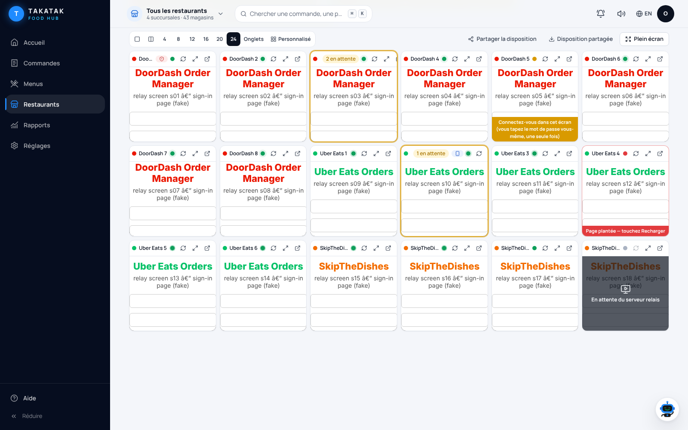
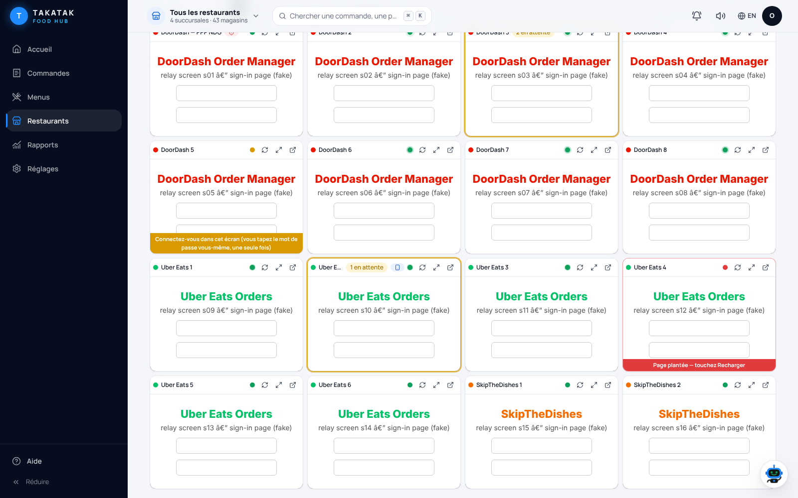
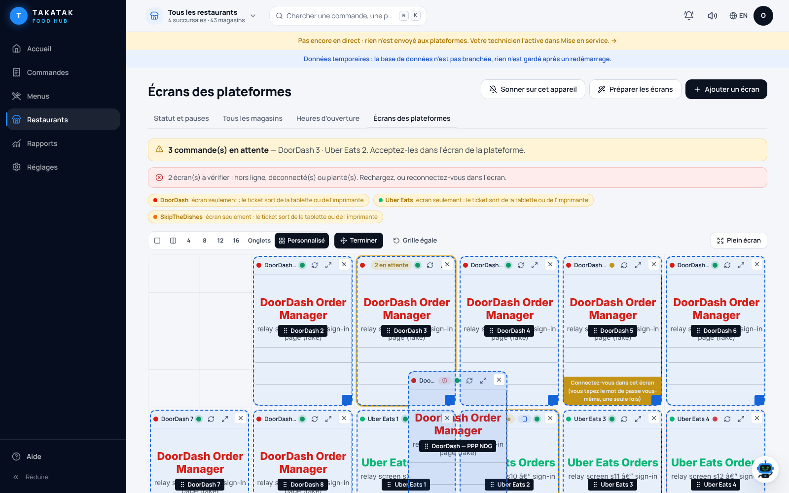
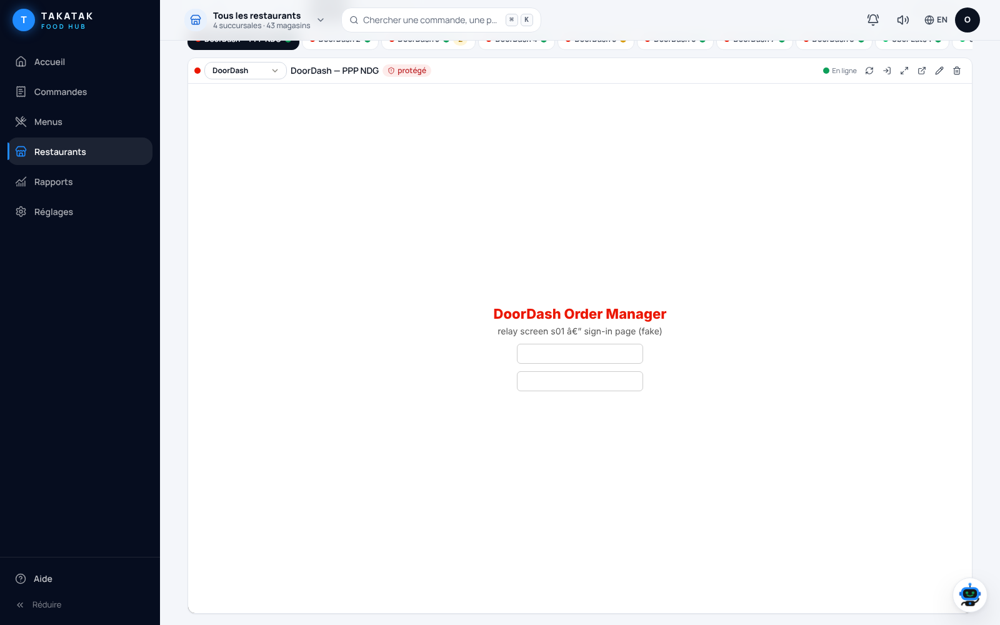
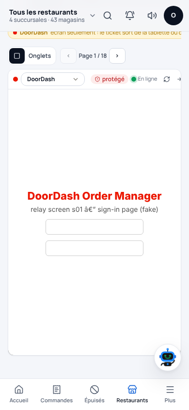

# Order screens rescue: tablets that drop, stores that get paused

_Started 2026-10-29. Live task board: the pinned agent board https://github.com/takatakca/foodhubca/issues/105 (one line
per comment, job "order screens lane A/B").
Store-by-store state and the owner's steps: the Drive note "Écrans de commande — état des magasins" in
"00 — Opérations TAKATAK" (private: never copy it here)._

## The problem

DoorDash and Uber Eats tablets in the stores lose Wi-Fi or their sign-in. Orders then ring on nothing, the platform
pauses the store ("Temporarily closed" during opening hours) and, after repeated misses, deactivates it.

## The answer: every order screen runs on an always-on server, and one device rings

Food Hub already has **platform screens** (`docs/PLATFORM_SCREENS.md`): a real browser per platform account on a wired
relay host, shown inside Food Hub, watched by an agent that reports every 20 s (up, signed in, waiting count in the page
title) and opens a Watchtower incident when a screen is down during opening hours. This rescue extends it:

| Need from the owner | Answer |
|---|---|
| A screen per franchise account, DoorDash and Uber (and Skip) | One screen per platform account, as many as needed, generated from one list (lane B) |
| Web Order Manager in a browser | Exists (Chromium per account). Owner signs in once inside the screen |
| Android + Play Store, the real Order Manager app | Android mode on the relay host (lane B): the owner installs the app from the Play Store and signs in himself |
| Ring on one device | Screens wall in Food Hub rings when any screen has orders waiting (lane A) |
| Nobody accepts → escalate | Watchtower `screen_waiting`: orders waiting too long during opening hours → beep → SMS → call → owner (lane A) |
| Auto-accept | A toggle inside each platform app; the owner sets it in the screen. **Only with a kitchen ticket path** (Clover link or a printer), or accepted orders get cooked by nobody |
| Orders into Clover / reprint | Unchanged and official: the platform's own Clover link (`FOODHUB_VIA_CLOVER`) or the platform API. Screens are never scraped for orders (platform terms, account suspension risk) |
| Printer | The tablet's printer stays the fallback. A cloud screen cannot reach a store printer; the kitchen ticket comes from Clover |

## Hard rules for every agent (people or AI)

1. `foodhubca/CLAUDE.md` applies: never touch `main`; checks before every push; public repo (no keys, tokens, emails,
   phone numbers, case numbers; store lists live in Drive, not here).
2. **No password, SMS code or 2FA code is ever typed, stored, sent or asked for by an agent.** The owner signs in inside
   each screen himself. "I will give you the usernames and passwords" is answered with: sign in yourself, once, in the
   screen; it stays signed in.
3. **Agents never click, accept, read or copy orders** on a platform screen, and never toggle settings in it.
4. **Po Poulet NDG (DoorDash store 27982486) is never touched**, even if it shows on a screen.
5. **One agent per portal account** (DoorDash portal, Uber Manager, each Gmail inbox, Coolify, Clover). Reactivating a
   store or answering platform support is operations work: the owner or the agent the owner names for that portal.
6. Each platform hears only about itself.

## Lanes (each lane owns its files; never edit another lane's files)

| Lane | Who | Branch | Owns these files | Tasks |
|---|---|---|---|---|
| **A: Food Hub side** | Claude cloud session "busy-cannon" | `claude/busy-cannon-5spy86` | `lib/foodhub/screens.ts`, `app/api/foodhub/screens/**`, `app/(console)/stores/screens/**`, `lib/ui/screens-ring.ts`, screen rules in `lib/foodhub/watch/*`, `tests/platform-screens.test.ts`, `docs/PLATFORM_SCREENS.md`, this file | A1 screens wall that rings · A2 `screen_waiting` alert · A3 heartbeat v2 (below) · A4 stores covered by each screen (Po Poulet NDG flagged) |
| **B: relay host side** | second Claude Code session | its own (`feature/screens-relay-kit` from `origin/main` if it has none) | `deploy/screens/**`, new `docs/PLATFORM_SCREENS_RELAY.md` | B1 generator: one list → compose for N screens · B2 Android mode (Play Store app) + `agent/android.mjs` · B3 in-store Windows PC kit (PowerShell) · B4 owner guide |
| **C: operations** | the owner (or the agent he names per portal) | none | none | reactivate paused stores · sign in once in each screen · auto-accept toggle · Coolify token |

`WORKLOG.md` and `docs/PROGRESS.md`: lane A writes the line for the whole effort; lane B puts its status in its pull
request and in the issue.

## What the wall looks like (test data: a fake relay host, 18 screens)

24 at a time (all 18 on one page) · 16 at a time · custom board (one screen dragged to the middle) · tabs · phone:







## Lane A status

- 2026-10-29: A1 screens wall that rings (Stores → Platform screens → "Ring on this device"), A2 `screen_waiting`,
  A3 heartbeat v2 accepted and stored (`mode`, `app`, `waiting`, `waitingSince`), A4 store numbers per screen with the
  protected ones flagged: **done**, tested (`tests/platform-screens.test.ts`). Lane B can rely on heartbeat v2 now.

- 2026-10-29 09:14: **lane B done** — `feature/screens-relay-kit` → #107 (generator, Android mode, Windows PC kit,
  guide). 09:45: lane A merged that branch into `claude/busy-cannon-5spy86` (merge, no rewrite) and added the v2.1
  items lane B had not picked up: the `open` command in both agents (`agent/commands.mjs`), `screens.18.example.json`
  (s01–s18, SCREEN_ID = the slot id, no `.env` line), each web screen served under `/sNN/` (`SUBFOLDER`), Skip start page
  aligned, and the guide's "18 numbered screens" + framing/sub-domain section. #102 now contains #107: merge #107 then
  #102, or #102 alone.

## Contract between lanes: heartbeat v2

```
POST /api/foodhub/screens/heartbeat        Authorization: Bearer <FOODHUB_SCREENS_AGENT_TOKEN>
{ "version": "agent-…",
  "screens": [{ "id": "<screen id from Food Hub>",
                "state": "ok" | "login" | "crashed" | "blank",
                "title": "(2) Orders",          // web mode: page title. Android: omit
                "url": "https://…",             // web mode: page address. Android: omit
                "autoReloads": 0,
                "mode": "web" | "android",      // v2, optional (default web)
                "app": "com.doordash…",         // v2, Android: package in front (no text from the screen)
                "waiting": 2 }] }                // v2, optional: count only (Android: number of the order app's
                                                 //   notifications). Food Hub uses it when the title has no "(n)"
→ 200 { "commands": [{ "id": "…", "kind": "reload" }], "unknown": [] }
```

- Android states: `ok` = order app in front and device online · `login` = the app's sign-in screen is in front ·
  `blank` = another app (or the home screen) is in front · `crashed` = device or adb not answering.
- `reload` for Android = bring the order app back to the front (`am start -a android.intent.action.MAIN -c
  android.intent.category.LAUNCHER -p <package>`: deterministic, no Monkey side effects). Nothing else is ever tapped.
- Fields not in v1 are optional, so a v1 agent keeps working.

### v2.1 (owner's ask 2026-10-29 04:20: "18 screens side by side, choose DoorDash / Uber Eats / Skip, ready to sign in")

- **Numbered screens.** Food Hub → Stores → Platform screens → **Set up screens** creates screens with fixed ids
  `s01`, `s02`… `s18` (up to 32) for one location, with so many DoorDash, Uber Eats and Skip. Each one's view address is
  `<base>/sNN/` (e.g. `https://screens.example.ca/s01/`). The relay host uses the same ids: `SCREEN_ID=s01`…, local
  port `31NN` (s01 → 127.0.0.1:3101 … s18 → 3118), reverse-proxy path `/sNN/` → that port. Nobody copies ids by hand.
- **Command `open`.** `commands: [{ "id": "s03", "kind": "open", "url": "https://order.doordash.com/" }]`. Sent when the
  owner sets up a screen or switches its channel, or taps "Sign-in page". The agent goes to `url` **only** if it is
  https on `doordash.com`, `ubereats.com`, `uber.com` or `skipthedishes.com` (or a sub-domain); otherwise it ignores it.
  Android: `open` launches the order app of that platform (`deploy/screens/agent/commands.mjs`, shared by both
  agents and tested against Food Hub's own list in `tests/screens-relay-commands.test.ts`).
- **Start pages** (Food Hub sends them; override with `FOODHUB_SCREEN_START_DOORDASH|UBEREATS|SKIP`):
  DoorDash `https://order.doordash.com/` · Uber Eats `https://merchants.ubereats.com/manager/orders` ·
  Skip `https://restaurants.skipthedishes.com/` (to confirm with the owner's Skip account).
- **One relay host for 18 screens:** about 0.5–0.8 GB RAM per Chromium screen → 8 vCPU / 16 GB for 18 (lane B states
  the real numbers it measures).

## How agents talk (so one can stop and the other continues)

All of it goes on the agent board #105, one line per comment, in its format:
`STATUS | agent: <name> @ <where it runs> | foodhubca · <branch> → PR | order screens lane X: <what> | next: <exact next step>`

- **Before starting:** read this file (from `origin/claude/busy-cannon-5spy86` until it is merged), the latest comments
  of #105 and the newest Drive note "Écrans de commande". Post `CLAIM` for your lane.
- **Every ~20 min, at every push, and before any long step:** post `UPDATE` with the branch, the SHA, the checks you ran
  and the exact next step. When something changed for the owner, add a new dated Drive note (never edit another
  agent's note).
- **Before stopping (credit, usage limit, end of task):** commit and push (WIP is fine), then post `PAUSED` or `DONE`
  with the next step. If a limit is near, post `PAUSED` first.
- **Taking over:** a lane is free when its last line on #105 is more than 60 minutes old and its branch has no newer
  commit. Post `TAKEOVER lane X from <agent>`, then continue from its next step on its branch (merge, never
  force-push).
- **Need something from the other lane:** post `ASK lane X: …`. Never edit its files to unblock yourself.

## Prompt for the second agent (the owner pastes it into a new Claude Code session)

```text
You join the TAKATAK Food Hub "order screens rescue" as LANE B (relay host side). Another Claude Code session
("busy-cannon", lane A, Food Hub side) is working at the same time. Stay strictly in your lane.

0. READ FIRST, do nothing else before:
   - foodhubca CLAUDE.md and AGENTS.md (main belongs to the owner, checks before every push, public repo).
   - git fetch origin, then: git show origin/claude/busy-cannon-5spy86:docs/ORDER_SCREENS_RESCUE.md
     (the plan, the lanes, the heartbeat v2 contract, the hand-off rules).
   - The latest comments of the agent board https://github.com/takatakca/foodhubca/issues/105
   - docs/PLATFORM_SCREENS.md and everything in deploy/screens/ (what already exists).
1. CLAIM on #105 (one line): CLAIM | agent: <your name> @ <where you run> | foodhubca · <branch> → PR | order screens
   lane B | next: <step>. If lane B was claimed or updated by someone else in the last 60 min, do not take it: post ASK.
2. BRANCH: the branch your session was given; if none:
   git worktree add .claude/worktrees/screens-relay-kit -b feature/screens-relay-kit origin/main
   Never commit to main, never merge into main, never force-push, never rebase pushed commits.
3. YOUR FILES ONLY: deploy/screens/**, docs/PLATFORM_SCREENS_RELAY.md, and new test files tests/screens-relay-*.test.ts.
   Everything else (lib/, app/, other tests/, docs/PLATFORM_SCREENS.md, docs/ORDER_SCREENS_RESCUE.md, WORKLOG.md,
   docs/PROGRESS.md) belongs to lane A: post "ASK lane A: …" on #105 instead of editing.
4. TASKS, in order:
   B1 generator: one list (deploy/screens/screens.example.json: id, platform, name, start URL, mode web|android)
      → a compose file for N screens (Chromium + agent per web screen, unique ports, persistent profiles). Refuse any
      list entry that carries a user name, password or token. Pure functions, tested.
   B2 Android mode: optional compose profile (needs a Linux host with KVM or binder): an Android container with the
      Play Store and a web view of its screen; agent/android.mjs speaks heartbeat v2 exactly as in the plan (mode
      "android", app = package in front, waiting = count of the order app's notifications, never their text); "reload"
      only brings the order app back to the front. The owner installs the apps from the Play Store and signs in himself.
   B3 in-store Windows PC kit (PowerShell): one Chrome profile per screen with its debugging port, starts at sign-in,
      a watchdog that restarts a closed window, and agent.mjs per screen with Node 22.
   B4 owner guide docs/PLATFORM_SCREENS_RELAY.md: plain words, French first, 30 minutes, step by step.
5. NEVER: type, store, paste or ask for any password, SMS or 2FA code (the owner signs in inside each screen himself);
   click, accept, read or copy orders on any platform screen, or change its settings; open the DoorDash, Uber, Clover,
   Coolify or Gmail accounts (operations are the owner's); touch Po Poulet NDG (DoorDash store 27982486); name another
   platform in a platform message; commit keys, tokens, .env values, emails, phone numbers or store lists.
6. CHECKS before every push: npm run typecheck, npm run lint (0 errors), npm test; node --check on every .mjs you add;
   docker compose -f <generated file> config when Docker exists.
7. NOTES so nobody loses work: post UPDATE on #105 every ~20 minutes, at every push and before any long step
   (branch, SHA, checks, exact next step). Before stopping for any reason (credit, usage limit, done): commit and push
   (WIP is fine), then PAUSED or DONE on #105 with the exact next step. When something changes for the owner, add a
   new dated note in Google Drive folder "00 — Opérations TAKATAK" (never edit another agent's note).
8. TAKEOVER: if lane A's last line on #105 is more than 60 minutes old and its branch has no newer commit, you may
   continue lane A: post TAKEOVER first, then work on its branch from its next step (merges only).
9. FINISH: open a PR to main "feat(screens): relay kit — N screens, Android mode, in-store PC" (what changed, checks,
   owner steps), post DONE on #105, and report to the owner: branch, SHA, checks, owner steps,
   "ready for owner review/merge".
```

## Owner decisions waiting (nothing built for these yet)

1. **"Re-enter in Clover" from a screen** (the owner's "recreate / reprint"): for a platform with no Clover link, a quick
   form on the screen's tile (platform order code, items from the menu, note) that creates the Clover order and the
   kitchen ticket through Food Hub's normal pipeline, marked as entered by hand, with no call back to the platform.
   Risk: a double order if that platform's own Clover link is also on (rule: one path per order). Build only once the
   owner says which platforms stay "screen only".
2. **Alert "order on the screen, nothing in Clover"**: a screen shows a new order and no order from that platform reached
   Food Hub / Clover within a few minutes. Useful once each platform's Clover path is known; false alarms otherwise.
3. **Skip start page:** `restaurants.skipthedishes.com` (Food Hub default) or `partner.skipthedishes.com` — confirm with
   the Skip account, then set `FOODHUB_SCREEN_START_SKIP` if needed.
4. **Auto-accept** inside each platform screen: only where a kitchen ticket still comes out (Clover link or printer).
