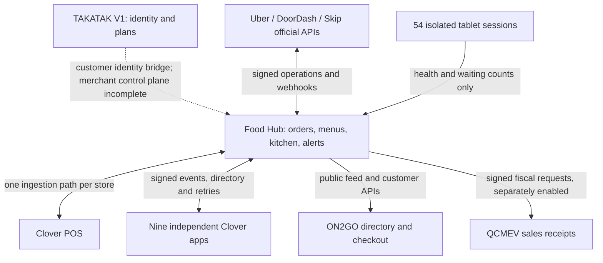

# One Food Hub, three provider workspaces, 54 virtual tablets

The restaurant console keeps Food Hub as its operational center. A persistent workspace bar switches between **Food Hub**, **Uber Eats**, **DoorDash** and **Skip**. Each provider workspace uses familiar order/menu/store/report/payment sections, existing Food Hub pages, the same authenticated user and the same location/brand selection. Food Hub retains its own identity and design.

Selecting a workspace is a view change. It never changes an account's provider, sends a command to a provider, signs in, or proves an API integration is connected. Unsupported native-portal actions still need the provider portal. Menu publication retains its explicit target selection and confirmation.

## What works in this change

- One shared `?kitchen=&brand=&channel=` scope controls navigation. The selected workspace survives links, reload and browser history. The three provider workspaces open even before API stores are mapped, so manual tablets can be used during onboarding.
- Screen preparation now proposes only missing sessions toward 18 per provider. Existing mixed 8/6/4 installations can be extended without duplicating or reassigning their first 18 accounts; a complete 54-account installation proposes zero additions.
- The Windows manifest limit now matches the hub’s 99 slots (the previous 50 limit rejected 54). Existing profiles/startup configuration must be inspected before any PC-side update.
- Virtual tablets are reachable from the workspace bar. The existing setup creates **18 DoorDash + 18 Uber Eats + 18 Skip = 54** independent sessions with IDs s01–s54. This change preserves those profiles and adds provider/location filtering of the wall.
- Grid, list, tabs and custom layouts still work. Viewing one provider does not delete hidden tiles or change their provider assignments. A provider account can contain several brands, so account screens are not falsely narrowed by a brand filter.
- Waiting and dropped-screen alerts monitor the full authorized screen list. A hidden waiting alert selects the correct location/provider and tablet. Dedicated kitchen devices continue to see all providers in their fixed location.
- Finance reads follow the selected platform. Order-level reconciliation and cases also honor supported location/brand filters. Bank-level payouts, ledger entries and statement batches remain account-level, explicitly labeled. Reconciliation refresh remains explicitly all-platform; the workspace is not implied authorization for a narrower financial mutation.
- Existing server permission checks and merchant/location boundaries remain in force. A provider switch grants no extra role, store or API capability.

## Manual sign-in versus API connection

Each real tablet is a persistent browser (or a supported Android order app) on the screen relay host. The owner types their username/password and any verification code **inside that provider's real sign-in screen**. Food Hub does not collect those passwords. Session profiles live on persistent relay volumes. The authenticated relay reports health/waiting counts and receives reload/open commands; it does not scrape orders or click accept.

Official order/menu/payment operations remain on the provider API or configured Clover/Order Relay ingestion path. A browser logged in to DoorDash does not supply DoorDash API approval. A copied visual layout would not make an unsupported API endpoint available.

## Connected architecture



The complete 22-repository evidence matrix and unfinished work are in [PLATFORM_INTEGRATION_AUDIT.md](PLATFORM_INTEGRATION_AUDIT.md). Business invoices (Facturations), marketing/SEO, training and private knowledge retain their separate authorities and release gates.

## Repeatable local verification

From `foodhubca`, with Node 22 and installed dependencies:

```sh
npm run typecheck
npm run lint
npm test
npm run build
npm run verify:foodhub
node scripts/verify-suite-workspace.cjs /workspace
PLAYWRIGHT_CHROMIUM_EXECUTABLE_PATH=/usr/bin/chromium node scripts/verify-platform-workspaces.mjs
```

The suite verifier uses actual checked-out producers, consumers, routes, retry queues and memory stores from Food Hub and all nine sibling apps. It checks both directions, signature/identity/expiry/tampering failures, duplicate handling and directory install/uninstall. Accounting, kiosk readiness and tracking effects are exercised where implemented. Transport is in-process Request/Response; this does not establish deployed HTTPS, database durability or every premium business workflow.

The browser verifier starts the built app with synthetic owner credentials, memory storage and live connectors disabled. It creates 54 synthetic tablet records, checks idempotent setup and authenticated heartbeats, provider filtering, existing-account reuse, cross-provider alert jumps, navigation/reload, mobile overflow and workspace accessibility. It also rejects a known Uber statement submitted as DoorDash without saving money records. Its local tablet HTML stands in for a relay view. It never signs in to a provider. Screenshots can be saved outside the checkout with `FOODHUB_WORKSPACE_SCREENSHOTS=/absolute/output/path`.

## What is still required for a working live platform

1. **Reuse the existing PC first:** the owner reports prior working PC setup. The Git history confirms a Windows install test and Chrome142/Windows11 startup fix on October29; current production sessions are not visible from this Linux cloud. Follow [EXISTING_PC_RELAY.md](EXISTING_PC_RELAY.md) to read existing status and preserve profile IDs/cookies/startup settings. Use a separate relay host only if the existing setup lacks required capability or capacity. For 54 Chromium sessions the existing guide recommends roughly 16 vCPU/64 GB, or split hosts. Confirm measured capacity under real platform workloads; this development container is not a 24/7 relay host.
2. **Same-site relay domain and configuration:** align `FOODHUB_ORIGIN`, gateway access, `FOODHUB_SCREENS_AGENT_TOKEN`, `FOODHUB_SCREENS_VIEW_HOSTS`, DNS, certificates and persistent storage. For new hosts, generate manifests with `deploy/screens/generate.mjs`. For the existing PC, extend the manifest referenced by its `kit.json` with the exact new IDs/providers; do not replace its existing assignments with a factory 54-screen preset. Creating hub records does not itself start PC browsers.
3. **Owner session verification:** reuse existing authenticated profiles; sign in manually only where the provider has expired the session. Test session restart/expiry. Skip's real order workflow may require its Android Partner app; confirm the available live order page/app before rollout.
4. **Official provider acceptance:** production/sandbox access and configured credentials for each required API. Verify one authorized order per platform/location through receipt, Clover, acceptance, ready/cancel and recovery, with duplicate protection. Keep fallback tablets until verified.
5. **App runtime connections:** isolated databases, per-app suite URLs/secrets, merchant OAuth/install records and deployed delivery/restart tests. Compatible signatures are necessary but do not configure deployments.
6. **Unfinished product work:** Food Hub's V1 merchant entitlements/usage are still foundation code without production callers. Several suite premium workflows and native device/payment paths remain future work. These are explicitly identified in the audit; none is reported complete by this change.
7. **Environment build prerequisites:** the prior onboarding draft includes `binaries.prisma.sh`, `fonts.googleapis.com` and `fonts.gstatic.com`. The running proxy still denies them until the environment configuration is applied, blocking dashboard/QCMEV full validation. Preserve TLS and checksum checks.

No production configuration, provider account, financial posting, order-routing cutover, main-branch merge or deployment is performed by these local checks.

— signé : Codex (unified-platform-workspaces) @ Codex cloud · 2026-11-04
