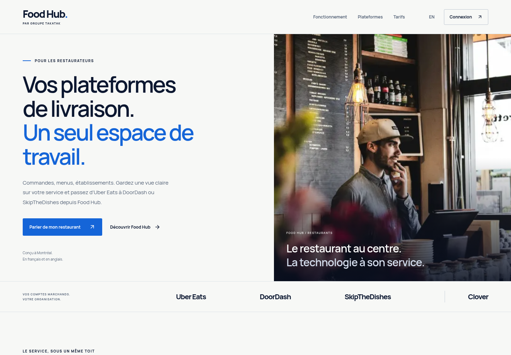

# Agent 2 — Food Hub public marketing site

Branch: `feature/foodhub-restaurant-marketing`. This log records this agent's work and verification; branch publication is coordinated without switching the shared integration checkout.

## 2026-11-04 — active: complete public restaurant journeys

Extending the reviewed landing experience to pricing, delivery-platform/Clover integration pages, kitchen display, Phone AI and a bilingual help page. The legacy subpages still use ON2GO.ca as the software name, generic cards and inactive marketplace-status controls. Their copy also overstates unverified provider access. A separate functional gap was found: Phone AI reuses the Food Hub installation URL and structured Offer, which can send a visitor to the wrong application.

Implemented the shared editorial shell across all eight page families, including the new `/hub/aide` and `/en/hub/help` routes. Rewrote provider, kitchen and Phone AI copy around configured workflows and actual access/setup/test requirements. Pricing presents Food Hub and Phone AI separately, with their correct billing units. Phone AI install links and structured Offers now require the Phone AI live listing; Food Hub availability cannot activate them. Software metadata consistently names Food Hub, the publisher GROUPE TAKATAK, and the separate protected Clover app names. Existing URLs and provider noindex gates remain intact.

Verification so far: **72/72** focused public-page/journey/legal tests pass, TypeScript and scoped lint pass, and source is frozen for the coordinated production build. Regressions cover all four Food Hub/Phone AI availability combinations, same-page language twins, valid local anchors, help route discovery, distinct plan units and the complete legal minute-counting definition. A browser check is prepared for all 32 bilingual desktop/mobile page states, 32 accessibility scans and the linked public destinations. Next: review the fresh production build in the browser and correct any actual issues. No production deployment or provider approval is implied.

The two public-page assertions in `scripts/foodhub-e2e.mjs` were updated with the coordinator's approval: preserve the pending-provider noindex/configured-page indexable distinction while checking the actual activation disclosure, and verify the Food Hub identity in `llms.txt`. No other E2E behavior changed.

Additional journey review found that `/legal/support` exposed configuration placeholders and an unsupported default response-time promise when contact settings were absent. With coordinator approval, marketing/help CTAs and support presentation now use the group's published `support@takatak.ca` address as a fallback, with configured Food Hub email precedence. The public footer shows a copyable address; an unconfigured phone is omitted. Raw environment placeholders and the same-day response promise were removed from the support page. The central legal identity, country, pricing and privacy disclosures were preserved. This provides a usable contact route without claiming that a message was sent or delivered.

## 2026-11-04 — final source, media and browser review complete

The target is `/hub` in Canadian French and `/en/hub` in English. Sources: current `BRAND.md`, public-hub pricing/legal/SEO code, the GitHub agent board, the existing image/video brief, ON2GO image-library rules, and the recovered media requirements. Food Hub addresses restaurant operators; ON2GO serves diners.

Implemented a restrained editorial page with a genuine, credited restaurant photograph; short bilingual Food Hub copy; operational features; an actual local sandbox tablet-wall capture; setup steps; neutral provider availability; pricing from existing constants; native FAQ; legal links; and a separate ON2GO diner link. The contact CTA works while a Clover installation link is unavailable. It does not claim that all provider accounts are connected or approved.

The video player uses native controls, no autoplay, `preload="none"`, a poster, native caption tracks, a readable description and a clear demo label. Both French and English 30-second films, posters and captions are installed. The footage is actual language-matched Food Hub UI with fictional orders and local simulated relay screens; it does not demonstrate native provider sessions or production API authorization. Media provenance is recorded in `public/hub-media/CREDITS.md`.

Verification: 43 focused marketing tests passed. The coordinated production build and TypeScript checks passed; global unit checks reported 2,091 passed / 12 skipped, and lint reported no errors (one pre-existing devices warning). Actual browser review covered `/hub` and `/en/hub` at 1440, 768, 390 and 360 pixels: eight page states without horizontal overflow, broken images or page errors; working native mobile navigation and FAQ disclosures. Both films and caption/poster routes returned successful public responses, MP4 byte-range requests returned 206, and browser metadata confirmed 30 seconds at 1920 × 1080 with controls and no autoplay.

The visual pass improved mobile reading size and the provider strip, supplied a matching English tablet-wall capture, and corrected contrast and accessible wordmark naming. The final coordinated production rebuild passed. A strict rerun against that fresh build passed all eight FR/EN viewport states; two WCAG 2/2.1 A/AA axe scans returned **zero violations**. No browser page errors, broken images or horizontal overflow were found. Native mobile navigation and FAQ controls worked. All eight media route/metadata checks passed again. The two public posters were compared by SHA-256 to the final steady-frame exports and matched exactly.

Final source and assets are frozen for branch publication. No source checkout switches, shared-tree commits, production credentials, native provider sessions or deployment were changed by this agent. Production deployment has not been verified.

Review artifacts are stored outside the checkout at `/workspace/platform-review/marketing-browser/` (eight viewport and eight full-page screenshots, section details and JSON results). The reproducible browser script is `/workspace/platform-review/check-hub-marketing.mjs`, using `LANDING_REVIEW_BASE` for the built review server. Next: root publishes this agent's reviewed source on `feature/foodhub-restaurant-marketing`; production release follows the existing deployment process and live verification.

— Codex, agent 2 @ cloud, 2026-11-04

## Published visual evidence

[Full page](evidence/02-marketing/fr-1440-full.png) · [French mobile](evidence/02-marketing/fr-390-hero.png) · [English mobile](evidence/02-marketing/en-390-hero.png) · [Browser/media results](evidence/02-marketing/results.json). These are local built-app review captures.
