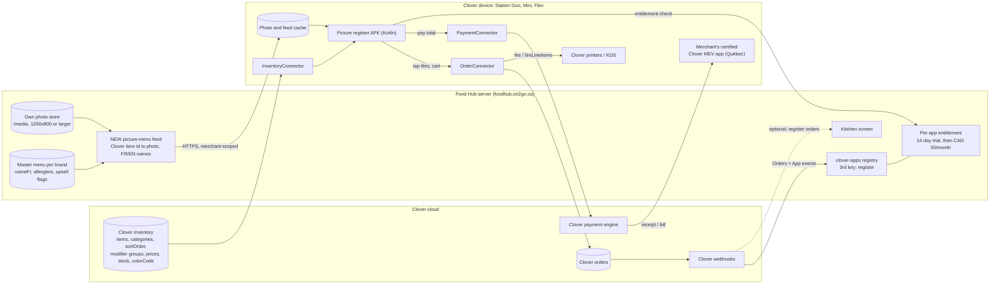

# Architecture: Clover picture register and kiosk

> **FR — En bref.** La caisse photo est une **appli Android native (Kotlin)** sur l'appareil Clover. Elle lit le
> menu Clover sur l'appareil (articles, catégories, options, prix, rupture), ajoute nos photos et nos noms
> français venant de Food Hub, crée une vraie commande Clover, l'envoie en cuisine par Clover et ouvre l'écran de
> paiement Clover. Le serveur Food Hub reçoit une 3ᵉ clé d'appli Clover (comme Phone AI) et un flux « menu photo ».
> La borne grand écran (phase 2) réutilise la page de commande web existante et paie sur un Mini ou Flex relié.
>
> **EN — In short.** The picture register is a **native Android app (Kotlin)** on the Clover device. It reads the
> Clover menu on the device (items, categories, modifiers, prices, stock), adds our photos and French names from Food
> Hub, writes a real Clover order, fires it to the kitchen through Clover and opens Clover's payment screen. The Food
> Hub server gets a 3rd Clover app key (like Phone AI) and a "picture menu" feed. The big-screen kiosk (phase 2) reuses
> the existing web ordering page and pays on a paired Mini or Flex.

Labels: **FACT** (Clover docs or the repo at origin/main b40e446), **INFERENCE** (design choice or reasoning).
Clover facts and their sources are in [RESEARCH_CLOVER_TECH.md](RESEARCH_CLOVER_TECH.md).

---

## 1. Device app vs web: options compared

| Option | Runs where | Verdict |
|---|---|---|
| A. Web app only (like Food Hub, Phone AI) | Opens from the Merchant Dashboard, not on the device as a register (FACT) | **Rejected**: cannot be the register screen |
| B. **Native Kotlin APK** with Clover Android SDK + connector SDK | On the device (merchant screen of Station Duo, Mini, Flex) | **Recommended for P1 and P2a** |
| C. Kotlin shell + WebView showing a Food Hub tile page, JS bridge to native connectors | On the device | Fallback. Reuses more web code, but needs the network for the page unless bundled, adds a bridge to secure, and Clover discourages cross-platform stacks (FACT: Kotlin/Java preferred) |
| D. Web kiosk on a big non-Clover screen + Clover Mini/Flex for payment (REST / Cloud Pay Display, RAID) | Tablet or 24" screen + Clover payment device | **Recommended for P2b** (big French kiosk); separate approval track |
| E. Replace or reskin Clover Register / become the launcher | — | **Rejected**: no official path; impersonation ban (FACT) |

Why B over C for the register (INFERENCE): the parts that matter (orders, payment, printing, inventory, offline read
of synced data) are native connector calls anyway; the tile grid is simple; native keeps working when the internet
drops (Canada has no offline card payments, but staff can still build the order and take cash); fewer moving parts in
review.

## 2. Data flow

Step by step:

1. **Menu.** The app reads items, categories (with `sortOrder`), modifier groups (min / max / required), prices,
   `colorCode` and stock from **InventoryConnector** on the device (FACT: Order Connector tutorial uses
   InventoryConnector). This works from data already synced to the device (UNCONFIRMED for offline; to test).
2. **Pictures and names.** The app downloads a small **picture-menu feed** from Food Hub: for each Clover item ID, the
   photo URL from our `/media` store, the French and English names and descriptions, allergen tags and the Duo / Trio /
   Combo flag. Photos are cached on the device. No photo → a `colorCode` tile with the name (FACT: Clover items carry a
   colour). Clover's `MenuItem.imageFilename` is only an optional seed (FACT: no official image URL).
3. **Order.** Tapping tiles builds a cart; the modifier sheet enforces min / max / required; the upsell step offers
   Duo / Trio / Combo once, with the drink always chosen (owner rule). "Send" writes a real Clover order through
   **OrderConnector** (line items, modifications, discounts) and fires it to the kitchen (`fire` / `fireLineItems`,
   FACT since SDK v306), so Clover's own printer labels and KDS routing apply.
4. **Payment.** "Pay" hands the order total to **PaymentConnector** (FACT: the Canadian path). Clover's secure screen
   takes the card, the tip (at sale time; no tip adjust in Canada) and prints the receipt. The app never sees card
   data. In Québec, the bill comes from Clover plus the merchant's certified MEV app (INFERENCE, to confirm; see
   LEGAL_AND_MARKET.md §1).
5. **Back office.** Clover webhooks (Orders, App) reach Food Hub. Today `lib/foodhub/pos/clover-website-orders.ts`
   classifies a Clover order as `website`, `platform`, `foodhub` or `other`, and only shows website / Food Hub orders on
   the kitchen screen (FACT). Register orders would be `other` and stay out of Food Hub unless we add a `register` kind
   (optional; Clover's KDS and printers already cover the kitchen).

## 3. What changes on the Food Hub server

All of this is **future work**, not in this PR.

| Change | Where (FACT: current code) | Pattern to copy |
|---|---|---|
| Add a 3rd app key, e.g. `register` | `lib/foodhub/pos/clover-apps.ts` (`CloverAppKey = 'foodhub' \| 'phone'`, `CLOVER_APP_KEYS`, `DEFS`) and the badge copy in `lib/foodhub/clover-apps.ts` | The `phone` entry: own App ID, secret, webhook auth, token store, callback, webhook path, events, name |
| Own install routes and token store | `lib/foodhub/pos/clover-oauth.ts` (per-app argument), `app/api/foodhub/clover-connect/phone/*` | `/api/foodhub/clover-connect/register/{start,callback}`, store `clover_oauth_merchants:register` |
| Own webhook | `lib/foodhub/pos/clover-webhook-gate.ts`, `app/api/foodhub/webhooks/clover/phone/route.ts` | `/api/foodhub/webhooks/clover/register`, App events (+ Orders if register orders should show in Food Hub) |
| Per-app paid check | `lib/foodhub/pos/clover-entitlement.ts` (`voiceAiEntitled`, `appInstalled`) | Generalize to `appEntitled(app, merchantId, purpose)`: same `billing_info` read, trial, ACTIVE, LAPSED with 7-day grace, 15-min cache |
| Picture-menu feed | `lib/foodhub/menu/clover-import.ts`, `lib/foodhub/storefront/catalog.ts` (`PublicMenu` with `imageUrl`), `lib/foodhub/types.ts` (`nameFr`, `allergens`) | New route returning the brand menu keyed by Clover item ID, scoped to the calling merchant |
| Device authentication to the feed | — | INFERENCE, to verify in P0: the APK gets a merchant token from Clover's Android SDK; the server checks it against Clover (merchant ID + app ID) before serving the feed. No shared secret inside the APK |
| Owner's own merchants never billed | `PHONE_OWN_MERCHANTS`, `FOODHUB_BILLING_EXEMPT_MERCHANTS` in `docs/CLOVER_MULTI_APP.md` | A `REGISTER_OWN_MERCHANTS` equivalent, or one shared "own merchants" list |

**Before any outside merchant:** per-merchant data isolation (FACT: the backend serves one restaurant group today;
outside installs stay "pending" until the owner approves them, `docs/CLOVER_MARKETPLACE_LAUNCH.md` §9).

## 4. Reuse of Food Hub code

| Need | Reuse (FACT: file exists on main) | How much |
|---|---|---|
| Tile data (items, categories, modifier groups) | `lib/foodhub/menu/clover-import.ts`, `lib/foodhub/pos/clover.ts` `importMenuFromClover` | High (server side, for the feed) |
| Photos | `lib/foodhub/media.ts`, `app/api/foodhub/media/route.ts`, `app/media/[name]/route.ts`, menu editor upload | High. Missing: resized thumbnails for tiles (no image resizer today) |
| French names, allergens, sort order, hours | `lib/foodhub/types.ts`, `lib/foodhub/menu/shared.ts`, `lib/foodhub/menu/verify.ts` (`no_photo` tip) | High |
| Sold out (86) | `lib/foodhub/clover-sync.ts`, `lib/foodhub/order-tools/quick-86.ts` | High (grey tiles); the device also reads Clover stock directly |
| Upsell Duo / Trio / Combo | `isUpsellGroup` in `lib/foodhub/storefront/catalog.ts`; `lib/foodhub/storefront/cart.ts`; `lib/foodhub/phone/cart.ts` | High as **rules** (ported to Kotlin for the APK; reused as-is for the web kiosk) |
| Server-side pricing | `priceCart` in `lib/foodhub/storefront/cart.ts` | High for the web kiosk; the APK lets Clover price the order |
| Customer ordering page | `app/commander/[slug]/order-client.tsx`, `app/api/storefront/menu/[slug]/route.ts` | High for the P2b web kiosk logic; layout is a mobile list with a 96 px photo, needs a big-tile grid. Its hard-coded 14.975 % display tax must give way to Clover's tax rates |
| Order into Clover + kitchen print (REST) | `lib/foodhub/delivery/clover-direct.ts` (`atomic_order`), `lib/foodhub/pos/clover-order.ts` (`printKitchenTicket`, `print_event`) | High for the P2b web kiosk; the APK uses OrderConnector instead |
| Payment | `lib/foodhub/pos/clover-checkout.ts` (Hosted Checkout, card-not-present) | Low: a register needs card-present payment (PaymentConnector / Pay Display) |
| Staff order entry | `components/expansion/new-order-modal.tsx` (free-text lines) | Low |
| Tests | `tests/storefront-*.test.ts`, `tests/clover-*.test.ts`, `tests/media.test.ts`, `tests/helpers/storefront-fixture.ts` | Patterns to copy (Clover always mocked) |

**Shared with the parallel TAKATAK listings app** (takatak-v1, `docs/clover-takatak-app-research`): one photo store and
one menu source. The register reads them; it does not upload or crop photos on its own.

## 5. Where the APK code lives (INFERENCE)

A separate repo (for example `takatakca/clover-picture-register`) or an `android/` folder. A separate repo is cleaner:
Gradle, signing and APK releases do not mix with the Next.js build and its checks (`npm run verify:foodhub`). The
signing keystore is never committed (this repo is public) and is backed up off the VPS.

## 6. Kiosk mode (P2a, on a Clover device)

Same APK, a "kiosk" mode turned on by a manager:

- `CustomerMode` full screen, secure staff exit (employee PIN); `BOOT_COMPLETED` relaunch; `Lockscreen` auto-unlock
  (Employee Read); `keepScreenOn`; idle / attract screen; on an unhandled error, leave customer mode and lock the
  device (FACT: Clover Kiosk rules).
- Pay with the kiosk payment intent where available (`KioskPayRequestIntentBuilder`, `setAllowPartialPayments(false)`),
  otherwise PaymentConnector; full payment only.
- French by default; 48 dp touch targets; WCAG A minimum, AA aimed.
- Alcohol hidden (or held for staff ID check). Semi-attended only.

## 7. Big-screen web kiosk (P2b)

- A full-screen browser page served by Food Hub on a tablet or 24" Android screen, built from the storefront code
  (catalog, cart, upsell, server pricing).
- Order written with `atomic_order` (existing `clover-direct.ts`); payment pushed to a paired Clover Mini or Flex
  through REST / Cloud Pay Display (FACT: supports Flex, Mini, Compact; Canada in the page header).
- Needs a Remote App ID (semi-integration approval) and steady internet (FACT: Cloud Pay Display).

## 8. Security and privacy (INFERENCE)

- No card data ever in our code, logs or storage; PaymentConnector / Pay Display only.
- The feed returns only that merchant's menu; device requests are checked against Clover before serving.
- No customer personal data collected by default (no name, phone or email at the register).
- Permissions asked, each with a reason for the review: Orders read + write, Inventory read, Employees read (kiosk
  unlock), Merchant read; printing through Clover's own order flow.
